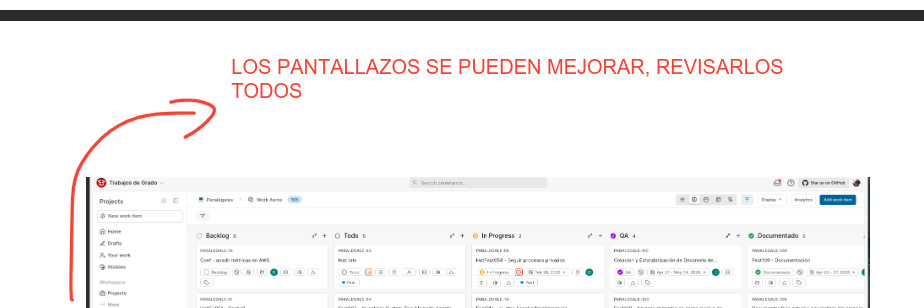

las siguientes son las correcciones que hizo el evaluador del trabajo de grado los cuales (ver los pantallazos).

1. ✅ RESUELTO — resumen acortado a un párrafo, palabras clave reducidas a 5 y se añadió el *Abstract* en inglés (`sections/0.1-resumen.tex`).

2. ✅ RESUELTO — se eliminaron los ~55 incisos delimitados por raya (—) en todo el documento, reescritos con comas, paréntesis, dos puntos o división de oraciones. Solo se conservaron los guiones ortográficos de compuestos y el nombre del patrón `Handler--Service--Repository`.

3. ✅ RESUELTO — el marco teórico pasó de 1 a 3 subsecciones: se añadieron "Leyes de la evolución del software" (Lehman) y "Teoría de la deuda técnica" (Cunningham, Kruchten et al.), con 2 referencias nuevas en `bibliografia.bib`.

4.

5. ✅ RESUELTO (parcial) — se auditaron las 34 figuras usadas y se aplicó redacción con rectángulos negros en 10 de ellas: nombres de partes de procesos judiciales, correos de terceros, alias y nombres del equipo, avatares con rostro real, `user_uid`/`payment_id`, y un token `oobCode` junto con la `apiKey` de Firebase. Se conservaron radicados (registro público), entidades, juzgados y los `correlation-id`. PENDIENTE de decisión del autor: tapar el ID de cuenta AWS `062141952574` y el principal IAM en Fig 6, 27 y 28; tapar los correos personales del autor en Fig 10 y 13; y limpiar el historial de git, donde los originales sin redactar siguen presentes.

6. ✅ RESUELTO — se mantuvo el alcance de automatización (solo reglas de Firestore) y se resolvió por exactitud y encuadre: se activaron en el CI de `paralegales-ui` los pasos de pruebas que estaban comentados, de modo que la afirmación del informe sobre la compuerta obligatoria pasa a ser cierta; se definió «aseguramiento de calidad» como proceso según IEEE 730 e ISO/IEC 25010 en el marco conceptual; el capítulo se reencuadró en ocho mecanismos a lo largo del ciclo de vida (con tabla matriz de momento y grado de automatización) en lugar de una sola capa de pruebas; se corrigió la afirmación falsa de que el backend carece de pruebas, atribuyendo la línea base en Go al equipo; los E2E pasaron de «no consolidados» a «implementados, no integrados»; y las conclusiones integran la observabilidad como control de calidad posdespliegue. Limitaciones y trabajo futuro reescritos en tres órdenes.

7. ✅ RESUELTO — se alineó lo que promete el marco teórico con lo que el trabajo reporta, sin inventar métricas. En el marco conceptual se delimitó qué se toma de SRE (instrumentación, SLI y alerta por umbral) y qué no (SLOs, error budgets, MTTR). En resultados se añadió la Tabla 5 con los cinco SLI realmente implementados (`RJURequestCount`, `RJU5xxCount`, `RJU4xxCount`, `RJULatencyMs`, `RJUStatusDistribution`) y las dos compuertas de alerta con sus umbrales verificados contra la plantilla de CloudFormation: más de 10 errores 5xx en 5 minutos y p95 sobre 5000 ms en 5 minutos. La ausencia de SLOs, error budgets y MTTR se declara como limitación con su causa (falta de periodo de observación y de registro de incidentes) y como trabajo futuro, con eco en las conclusiones.
