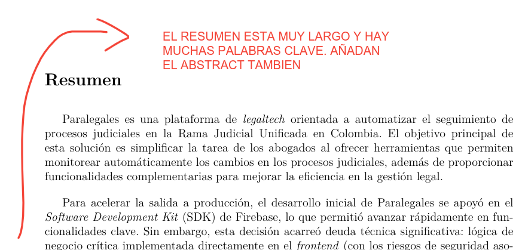
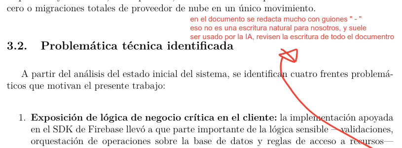
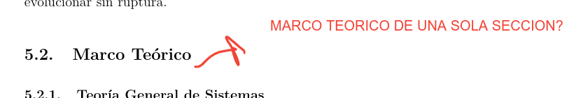
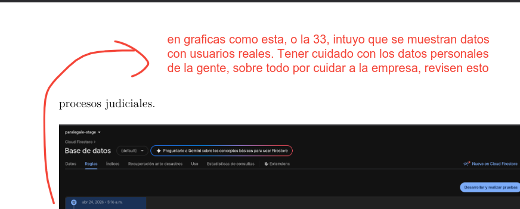
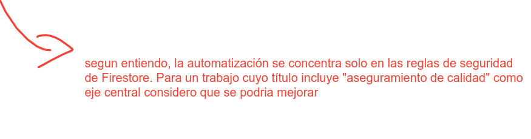
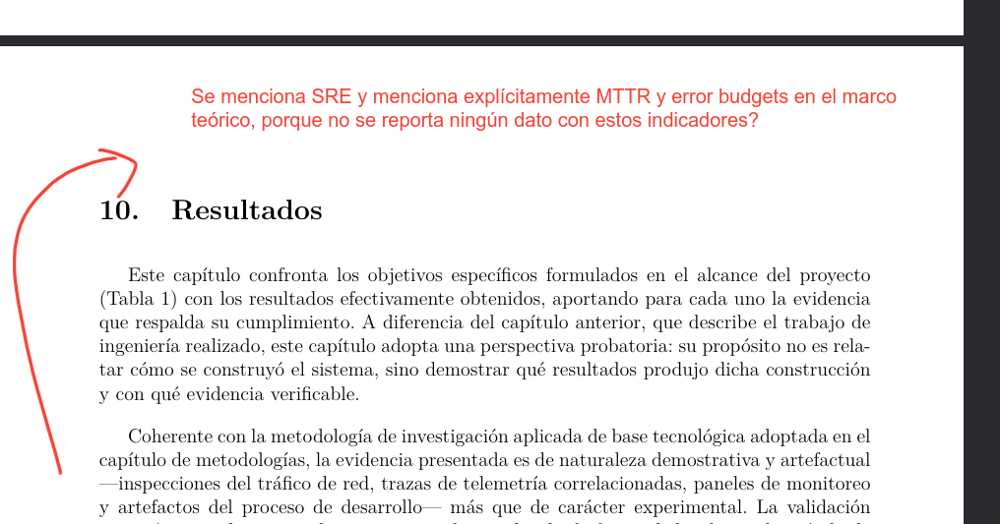

las siguientes son las correcciones que hizo el evaluador del trabajo de grado los cuales (ver los pantallazos).

> **Nota de estado.** Este archivo fue actualizado tras una auditoría de las siete
> observaciones contra el código fuente del informe y los repositorios
> `paralegales-ui` y `paralegales-services`. Varias afirmaciones de la versión
> anterior resultaron falsas o parciales y se corrigieron aquí. El plan de
> remediación derivado está en `correcciones/plan-remediacion.md`; las tareas T1 a
> T7 de ese plan ya están aplicadas al árbol de trabajo, y T8 y T9 siguen
> pendientes de decisión del autor.

1. ✅ RESUELTO — resumen acortado a un párrafo, palabras clave reducidas a 5 y se añadió el *Abstract* en inglés (`sections/0.1-resumen.tex`). **Commit:** `53902d9`. **Ajuste posterior (T5):** al podar de 8 a 5 palabras clave se había eliminado «Aseguramiento de calidad», que es la mitad del título del trabajo; se repuso sustituyendo `Domain-Driven Design` (técnica subordinada al objetivo B) y se aplicó el cambio simétrico en `Keywords` (`Software quality assurance`). Siguen siendo cinco.

   > **Transcripción:** «EL RESUMEN ESTA MUY LARGO Y HAY MUCHAS PALABRAS CLAVE. AÑADAN EL ABSTRACT TAMBIEN»

2. ✅ RESUELTO — se eliminaron los ~55 incisos delimitados por raya (—) en todo el documento, reescritos con comas, paréntesis, dos puntos o división de oraciones. Solo se conservaron los guiones ortográficos de compuestos y el nombre del patrón `Handler--Service--Repository`. **Commit:** `45e311e`. **Ajuste posterior (T4):** quedaba una ocurrencia de ` -- ` con espacios en `7.2-arquitectura.tex`, que LaTeX componía como raya y además introducía un segundo nombre para el patrón (`Handler -- Service Struct -- Abstract Repository`); se unificó a `Handler--Service--Repository`, que es como lo llama el resto del documento en ocho lugares. Verificado: `grep -rn -- "Handler -- Service" sections/` sale vacío y no hay rayas en ningún `.tex`.

   > **Transcripción:** «en el documento se redacta mucho con guiones " - " eso no es una escritura natural para nosotros, y suele ser usado por la IA, revisen la escritura de todo el documento»

3. ✅ RESUELTO — el marco teórico pasó de 1 a 3 subsecciones: se añadieron "Leyes de la evolución del software" (Lehman) y "Teoría de la deuda técnica" (Cunningham, Kruchten et al.), con 2 referencias nuevas en `bibliografia.bib`. **Commits:** `9ac3927` (añade 4 subsecciones y 6 referencias) y `87acf64` (elimina la subsección de modularidad y sus 4 citas). **Ajuste posterior (T6):** `Lehman1980` y `Kruchten2012` se citaban únicamente dentro de `4.2-marco-teorico.tex` y no aparecían ni una vez en los capítulos 7, 8 y 9, de modo que el marco añadido no gobernaba el resto del documento. Se añadieron dos invocaciones breves, reutilizando el vocabulario ya establecido en 4.2: una en `8.3-objetivo-b-arquitectura.tex` (el resultado del objetivo B como pago de la partida de deuda de mayor interés, deuda estructuralmente invisible) y otra en `9-conclusiones.tex` (Paralegales como programa de tipo E, la refactorización como el trabajo deliberado que exige la ley de complejidad creciente, y el resultado como pago selectivo con la porción restante hecha visible por telemetría).

   > **Transcripción:** «MARCO TEORICO DE UNA SOLA SECCION?»

4. ⚠️ **PENDIENTE ASUMIDO.** No se hizo ninguna mejora de los pantallazos y no se hará: el autor decidió que ningún archivo de `img/` se modifica, reemplaza, recorta ni regenera, de modo que la observación queda deliberadamente sin atender. **Riesgo asumido:** el jurado pidió revisar *todos* los pantallazos y va a comprobar si se revisaron; conviene tener preparada una respuesta oral que reconozca la limitación en lugar de presentarla como resuelta. Este ítem es también la razón por la que el ítem 5 no puede cerrarse (la redacción de datos personales exige editar las capturas) y por la que la Figura 35 seguirá mostrando corridas de CI de 1m 22s a 1m 33s, tiempos que no incluyen el aprovisionamiento del emulador de Firebase.

   > **Transcripción:** «LOS PANTALLAZOS SE PUEDEN MEJORAR, REVISARLOS TODOS»

5. ❌ **NO RESUELTO.** La versión anterior de este archivo lo declaraba «RESUELTO (parcial)», lo que no corresponde al estado del PDF compilado, y se contradecía a sí misma al declarar la Fig 10 como PENDIENTE mientras acreditaba `753d01c` como resuelta para esa misma figura.

   **Lo que efectivamente se hizo:** `ca0bd0c` aplicó rectángulos negros en 10 figuras (nombres de partes de procesos judiciales, correos de terceros, alias y nombres del equipo, avatares con rostro real, `user_uid`/`payment_id`, y un token `oobCode` junto con la `apiKey` de Firebase), y se conservaron a propósito radicados (registro público), entidades, juzgados y los `correlation-id`.

   **Lo que retrocedió:** `cde89da` **revirtió** la redacción de la Figura 3 (`fig9-webdesk-kaban-board.png`), de modo que el tablero WebDesk vuelve a mostrar el nombre completo de un tercero (~15 veces), avatares con rostro real y el correo del autor. `753d01c` tapó dos de los cinco correos de la Figura 10 y dejó visible el institucional.

   **Exposición que sigue presente en el PDF (verificada):**

   | Figura | Archivo | Expuesto |
   |---|---|---|
   | 3 | `fig9-webdesk-kaban-board.png` | Nombre completo de un tercero ×15, rostros reales, correo del autor |
   | 6 | `fig14-api-gateway.png` | Cuenta AWS `062141952574` + `AdministratorAccess/juan.felipe.monsalve` |
   | 10 | `fig17-sso-google.png` | Nombre completo + `…@correounivalle.edu.co` + rostro real |
   | 13 | `fig21-update-email-password-feature.png` | `jfmonsalveva@gmail.com` en claro |
   | 27, 28 | `fig33-…`, `fig34-…` | Cuenta AWS + principal IAM |

   **Por qué no se puede cerrar:** redactar estas capturas exige editar archivos de `img/`, y el autor decidió que ninguna imagen se toca. La única mitigación disponible sin tocar imágenes es retirar del `.tex` el entorno `figure` de las figuras más comprometidas (candidata principal: la Figura 3, que expone datos de un tercero identificable y es la de menor valor argumental) y reescribir el párrafo que la referencia; eso cambia contenido del informe y renumera las figuras posteriores, así que **requiere decisión expresa del autor** (T9 del plan de remediación, no ejecutada).

   **Corrección de dato:** el conteo «las 34 figuras usadas» es incorrecto; el `.lof` lista **35** figuras numeradas.

   **Acción de mayor impacto, pendiente y ajena al informe:** el repositorio `jfmonsa/trabajo-de-grado` es **público** (`gh repo view` → `"visibility":"PUBLIC"`) y las imágenes sin redactar siguen en el historial de git (commit `2402149`). Mientras siga público, el nombre del tercero, los rostros, los correos y el ID de cuenta AWS con `AdministratorAccess` son recuperables aunque el PDF quedara limpio. Pasarlo a privado no requiere tocar ninguna imagen.

   **Commits:** `ca0bd0c` (redacción de las 10 figuras), `753d01c` (dos de cinco correos en Fig 10) y `cde89da` (reversión sin redactar del tablero WebDesk).

   > **Transcripción:** «en graficas como esta, o la 33, intuyo que se muestran datos con usuarios reales. Tener cuidado con los datos personales de la gente, sobre todo por cuidar a la empresa, revisen esto»

6. ✅ RESUELTO, pero **no de la forma que decía la versión anterior de este archivo**. El reencuadre de `1cf7fa2` es válido y se conserva: se definió «aseguramiento de calidad» como proceso según IEEE 730 e ISO/IEC 25010 en el marco conceptual; el capítulo se reencuadró en ocho mecanismos a lo largo del ciclo de vida (con tabla matriz de momento y grado de automatización) en lugar de una sola capa de pruebas; se corrigió la afirmación falsa de que el *backend* carece de pruebas, atribuyendo la línea base en Go al equipo; los E2E pasaron de «no consolidados» a «implementados, no integrados»; y las conclusiones integran la observabilidad como control de calidad posdespliegue. **Commit:** `1cf7fa2`.

   **Sobre la compuerta de CI, verificado en el historial de `paralegales-ui`:** la integración de la *suite* de reglas al *pipeline* fue obra del autor. El commit `6d8ca13` (2025-04-04, jfmonsa) introdujo el *pipeline* con las pruebas de reglas, y los pasos se mantuvieron activos, sin comentar, al menos hasta `270c43b` (2025-05-17), como puede comprobarse también en `cf8e4fb` (2025-04-21). El commit `ad22fb3` (2025-05-17), de otro miembro del equipo, los comentó posteriormente. Por eso el informe describe la compuerta en pasado, como parte de la intervención documentada, y no como el estado presente del repositorio.

   **Redacción resultante:** el capítulo de pruebas describe un *pipeline* que se dispara ante cada *pull request* dirigida a la rama de integración y encadena dos verificaciones cuyo fallo interrumpe el *workflow*: la validación estática diferencial y la ejecución de la *suite* de reglas sobre la Firebase Emulator Suite. Dos precisiones que se incorporaron: el *trigger* es `branches: ["stage"]`, de modo que se habla de la rama de integración en singular y no de «las ramas protegidas»; y se afirma que el fallo interrumpe el *workflow*, sin afirmar que bloquee el *merge*, porque eso depende de los *required status checks* de la protección de rama, que no pudo verificarse por falta de permisos de administración.

   **Recuento de la tabla de mecanismos:** de ocho mecanismos, **cuatro** actúan como compuertas automáticas capaces de interrumpir la integración (análisis estático, Commitlint, reglas de Firestore y control del flujo de ramas), **tres** están automatizados sin operar como compuerta (pruebas en Go, E2E y observabilidad) y **uno** es manual.

   **Nota sobre la evidencia:** la subsección de CI ya no remite a la Figura 35 para respaldar la compuerta de reglas. Esa captura corresponde a las corridas #325 a #329, fechadas entre el 2026-03-28 y el 2026-05-11, casi un año posteriores a `ad22fb3`, y por tanto documenta un *pipeline* sin el paso de reglas. La evidencia de la integración es el historial de git citado arriba.

   > **Transcripción:** «segun entiendo, la automatización se concentra solo en las reglas de seguridad de Firestore. Para un trabajo cuyo título incluye "aseguramiento de calidad" como eje central considero que se podria mejorar»

7. ✅ RESUELTO — se alineó lo que promete el marco teórico con lo que el trabajo reporta, sin inventar métricas. En el marco conceptual se delimitó qué se toma de SRE (instrumentación, SLI y alerta por umbral) y qué no (SLOs, error budgets, MTTR). En resultados se añadió la Tabla 5 con los cinco SLI realmente implementados (`RJURequestCount`, `RJU5xxCount`, `RJU4xxCount`, `RJULatencyMs`, `RJUStatusDistribution`) y las dos compuertas de alerta con sus umbrales verificados contra la plantilla de CloudFormation: más de 10 errores 5xx en 5 minutos y p95 sobre 5000 ms en 5 minutos. La ausencia de SLOs, error budgets y MTTR se declara como limitación con su causa (falta de periodo de observación y de registro de incidentes) y como trabajo futuro, con eco en las conclusiones. **Commit:** `c68e4c0`.

   > **Transcripción:** «Se menciona SRE y menciona explícitamente MTTR y error budgets en el marco teórico, porque no se reporta ningún dato con estos indicadores?»

---

## Hallazgos colaterales de la auditoría (no observados por el jurado)

Detectados al verificar los siete ítems anteriores y corregidos junto con ellos.

- **C1, referencia cruzada pendiente de respaldo.** `8.3-objetivo-b-arquitectura.tex` afirma que «la verificación de ese desacoplamiento mediante pruebas unitarias con implementaciones *mock* del repositorio se documenta en el capítulo dedicado a las pruebas del sistema», y la palabra «mock» no aparece en ese capítulo. Se intentó reformular la oración, pero **el cambio fue revertido por decisión del autor** y el texto conserva su redacción original. Queda pendiente cerrar la brecha por el otro extremo: documentar esa validación en el capítulo de pruebas, con lo que la remisión pasaría a estar respaldada. En `paralegales-services` existen las cinco interfaces `Repository` del refactor, pero no se localizó ningún `*_test.go` que ejercite un *service* con un repositorio *mock*.

- **C2, actividad D del objetivo B.** Se reformuló la actividad en `utils/objetivos-especificos.tex` y **el cambio fue revertido por decisión del autor**: los objetivos específicos y sus actividades están formalmente aprobados y no deben modificarse. El archivo queda idéntico a su versión original. Sin efecto sobre el documento compilado: las macros `\objetivoEspecifico*Actividades` no se expanden en ningún `.tex`, de modo que el texto de las actividades no llega al PDF.