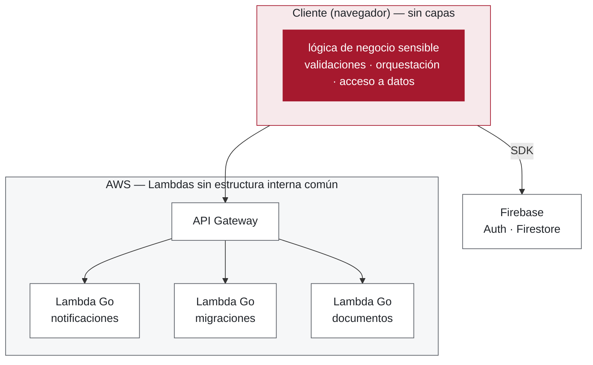

<!--
Slide 3 — Separador del Bloque 1: Contexto y problema (~8 s; el bloque completo, ~3 min).

═══ GUION ═══

"Primero el contexto: qué es Paralegales, como surge y en qué estado técnico se encontraba al inicio de
la pasantía."
-->

---
layout: two-cols-figure
columns: 0.95fr 1.15fr
figureHeight: 16rem
---

# Introducción

::left::

- El portal de la **Rama Judicial Unificada** no notifica cambios: revisión manual, con riesgo de omitir actuaciones que afectan los casos
- Congestión judicial en Colombia: **54,9 %** (CSJ, 2023)
- Oportunidad de negocio: automatizar el seguimiento de procesos
- Colombia: **2.º en el Legal Tech Index** en software jurídico
- Surge **Paralegales**, plataforma legaltech — **en producción, con usuarios reales** y desarrollo continuo

::figure::

*Dashboard principal: procesos seguidos, estadísticas y accesos directos*

<!--
Slide 4 — Introducción (~45 s).

═══ GUION (leer casi literal) ═══

"En Colombia, el seguimiento de un proceso judicial se hace consultando el portal de la Rama
Judicial Unificada, este no notifica cambios. Si aparece una actuación nueva, nadie
avisa: esto nos lleva a dos problemas importantes: 1. tedioso; 2. si eres un abogado independiente o firma con bastantes casos puede llevarte a omitir una actuación perjudicando tu parte en el proceso.

Dos datos dan la dimensión del problema: la congestión judicial en Colombia llegó al 54,9 %
en 2023, según el Consejo Superior de la Judicatura, y Colombia es el segundo país de la
región en el Legal Tech Index, que mide la adopción de software jurídico. Hay un volumen
grande de revisión manual, y hay mercado para automatizarla. [los dos datos, de pasada]

De ahí surge Paralegales, la plataforma de Webcloster que automatiza ese seguimiento.
-->

---
layout: two-cols-figure
columns: 1.2fr 1fr
---

# Punto de partida técnico

::left::

- Premisa: **salir rápido al mercado** para validar el producto
- **Firebase (BaaS)** desde el SDK — **lógica sensible a vulnerabilidades directamente en el frontend**
- **Lambdas Go** tras API Gateway, pero **monolíticas por dentro**: todo en el handler
- **Frontend sin capas**: UI, lógica y acceso a datos mezclados en los componentes
- Sistema **viable** con **deuda técnica** — y en producción: **sin reescrituras ni migraciones totales**

::figure::

*Evolución orgánica: la entrada estaba unificada, pero faltaban capas y patrones internos*

<EmphasisBox title="Deuda deliberada y prudente">
Correcta para esa etapa (Fowler/Kruchten) — este trabajo llega cuando empieza a cobrar intereses.
</EmphasisBox>

<!--
Slide 5 — Punto de partida técnico (~50 s).

═══ GUION (leer casi literal; sigue el orden de los bullets) ═══

"previa a la pasantia, El desarrollo inicial de Paralegales tuvo una premisa: salir rápido al
mercado para validar el producto.

Es decir se busco lanzar un MVP, un desarrollo muy rapido de las funcionalidades core del producto
aunque esto significara sacrificar la calidad

para esto las personas involucradas en esta fase del proyecto optaron por usar Firebase el cual un Backend-as-a-Service,
es decir con el te evitas en muchos casos tener que implementar una API para muchas funcionalidades pudiendo hacer operaciones
de lectura y escritura de la base de datos desde el frontend y ademas ya viene implementada la logica de autenticación

el abuso de esta libreria provoco que algunos como tuvieran logica de negocio sesible escrita en el frontend, esto es un
problema critico pues puede ser manipulada por un actor malicisoso

por otro lado otro problema importante fue la ausencia de una arquitectura a nivel de codigo y patrones de diseño a la hora de implementar modulos tanto
en el front como en el back. lambdas golang gigantes, codigo de componentes 

ligado a esto la parte del backend que si estaba implementado en una arquitectura de microservicios carecia de observabilidad lo que 
hace muy dificil encontrar en que parte de un sistema de microservicios orientado a eventos se esta generando un error y esto sumado
a que era un sistema en produción es un problema critico.

y por ultimo la ausencia de ciertas buenas practicas en el ciclo de desarrollo del software

-- mencionar el diagrama de alto nivel --

apoyandonos en nuestro marco teorico, Fowler y Krutchen nos dicen que esta deuda tecnica fue deliberada y prudente,
pues fue la desicion correcta para esta etapa del producto. este trabajo llega en que la deuda tecnica ya comienza a cobrar intereses volviendo insostenible

═══ PRECISIONES (no improvisar) ═══

- API Gateway YA existía: el problema no era la exposición de las Lambdas, era la falta de
  patrones internos y de capas. No presentarlo como si el backend no tuviera entrada.
- Enmarcar SIN culpar al equipo previo: la caja de énfasis (Fowler/Kruchten) es el tono.
-->

---
layout: grid-2x2
---

# El problema: cuatro frentes

::box1::

**1 · Lógica crítica expuesta en el cliente**

Validaciones, orquestación y reglas de acceso inspeccionables y manipulables desde el navegador: caso de *Insecure Design* (OWASP Top 10).

::box2::

**2 · Fragmentación arquitectónica**

Firebase y AWS coexisten sin patrones que gobiernen sus fronteras: sistema difícil de razonar y de evolucionar.

::box3::

**3 · Sin observabilidad transversal**

Sin telemetría unificada ni correlación entre componentes: diagnosticar un fallo obliga a revisar cada sistema por separado, a ciegas.

::box4::

**4 · Sin prácticas de aseguramiento de calidad en el ciclo de vida**

Análisis estático, formateo, integración continua, pruebas automatizadas y revisión de código **sin automatizar**: dependían de la disciplina individual.

<!--
Slide 6 — El problema: cuatro frentes (~55 s).

═══ GUION (leer casi literal; una frase por caja, SIN desarrollar) ═══

"Es muy importante tener en cuenta que cada problema de estos se mapea con un objetivo especifico y todo estos problemas
se buscaron solucionar en cada modulo intervenido por mi parte en la pasantia (tanto para funcionalidades nuevas como existentes)

═══ EL MAPEO (ahora sí es 1:1 — se puede afirmar) ═══

Frente 4 — precisión si la piden: la ausencia era de AUTOMATIZACIÓN, no de intención.
El equipo revisaba código; lo que no existía era la compuerta que lo hiciera obligatorio
(hooks, Commitlint, lint diferencial, CI con checks requeridos). Este frente nombra las
pruebas automatizadas entre lo ausente: eso ANTICIPA la pregunta "¿y sus pruebas?" —
la respuesta preparada está más abajo, en MUNICIÓN, y la slide 22 la sostiene.

═══ MUNICIÓN PARA PREGUNTAS (no es guion: no decirlo si no lo piden) ═══

Frente 1 — ejemplos CONCRETOS de lógica expuesta (evidencia en el git de paralegales-ui):
- Módulos vulnerables: SEGUIR / DEJAR DE SEGUIR PROCESOS y BÚSQUEDA DE PROCESOS.
- Antes de las reglas de seguridad, cualquier usuario podía manipular el SDK de Firestore
  desde el navegador para leer información de CUALQUIER otro usuario (sus datos, sus
  procesos seguidos) — no había restricción de propietario (isOwner).
- Los contadores de cuota vivían en el documento del usuario (searches,
  remaining_searches, followed) y eran escribibles desde el cliente: un usuario podía
  regalarse búsquedas ilimitadas alterando remaining_searches.
- El primer commit de firestore.rules bloquea toda la BD y lista como TODO la lógica que
  vivía en el cliente: redimir vouchers, follow/unfollow, verificación TOTP.
- El commit "delegate process follow/unfollow to backend" elimina ~350 líneas de lógica
  de negocio de los repositorios del cliente (useFollowProcesses) — la materialización
  del Objetivo A sobre ese módulo.

OJO terminología (frente 4): decir "prácticas formales de aseguramiento de calidad"
o "prácticas de ciclo de vida" — NO decir "QA" a secas: en el ámbito profesional se asocia
a test automatizados y ese no fue el centro del trabajo. El sentido aquí es SQA (IEEE 730):
aseguramiento de PROCESO (hooks, Commitlint, lint diferencial, CI con compuertas).

Si el jurado pregunta "¿dónde están sus pruebas automatizadas?" (respuesta de 20 s):
"El aseguramiento de calidad del trabajo es de proceso — SQA en el sentido de IEEE 730:
hooks, validación de commits, lint diferencial y CI obligatorio. Las pruebas automatizadas
se asignaron por riesgo: la suite de reglas de seguridad de Firestore (16 casos), donde un
fallo tiene el máximo impacto y el código mínima volatilidad, integrada como compuerta del CI.
Las limitaciones están declaradas en el informe como decisión de costo-beneficio, no como omisión."
-->

---

# Formulación del problema

> **¿Cómo evolucionar la arquitectura de la plataforma Paralegales hacia un diseño híbrido Firebase y AWS que mitigue la exposición de lógica de negocio crítica en el cliente, reduzca la fragmentación arquitectónica, introduzca observabilidad transversal y consolide prácticas de aseguramiento de calidad continuo, sin disrumpir el servicio en producción ni incurrir en el costo y el riesgo de una migración total de proveedor de nube?**

<EmphasisBox title="Restricción">
Evolucionar <strong>sin disrumpir el servicio en producción</strong>.
</EmphasisBox>

<!--
Slide 7 — Formulación del problema (~65 s, incluida la lectura de la pregunta).

═══ GUION (leer casi literal) ═══

═══ MUNICIÓN PARA PREGUNTAS ═══

- Si preguntan por las subpreguntas del informe: son 5, una por eje — cuatro mapean a los
  objetivos A–D y la #3 (qué queda en Firebase y qué va a AWS) es transversal: no produce un
  artefacto, produce el criterio de frontera con el que se decidieron los otros cuatro ejes
  (ataque #2 de defensa.md).
- SOLO SI EL JURADO LO TRAE: esta slide ya NO menciona la migración Firestore → DynamoDB
  (se presenta en la slide 11, alcance, y en la slide de apoyo "¿Por qué no migrar todo a
  AWS?"). No adelantarla aquí. Si preguntan por qué se descarta la migración total: se
  investigó, se midió su costo-beneficio y la empresa la descartó por decisión de producto.
  El respaldo está en la sección 2.3 del informe. No exagerar: fue una prueba de concepto
  medida y descartada por la empresa, no un benchmark formal publicado.
-->
