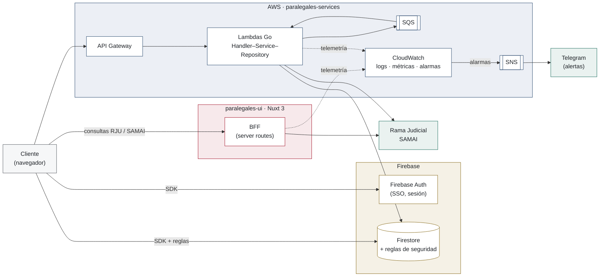
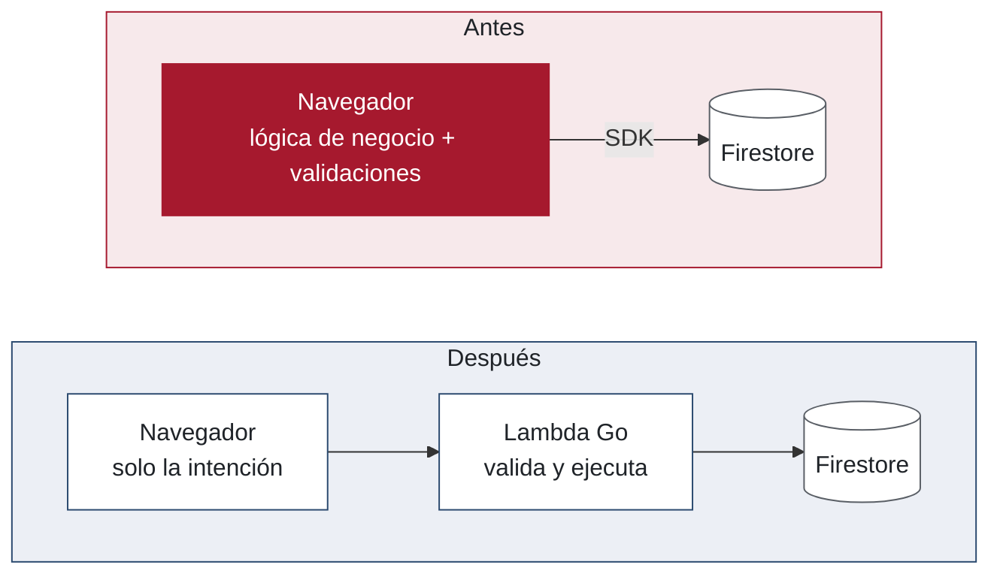
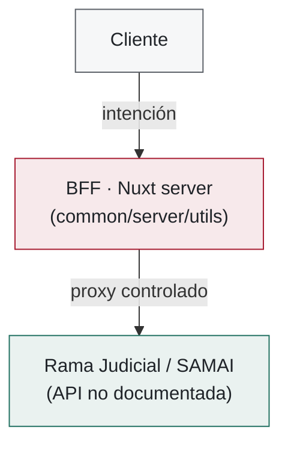
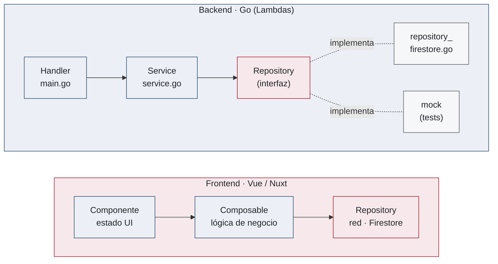
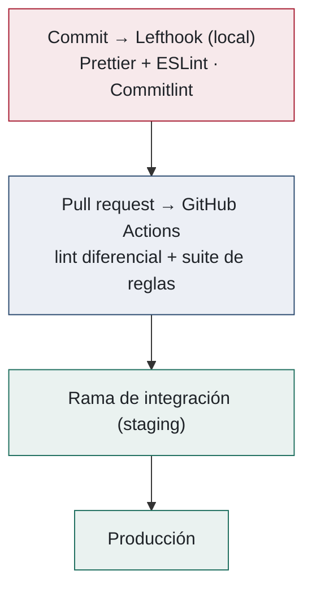

<!--
Slide 14 — Separador del Bloque 4: VERSIÓN CORTA (si vas retrasado en tiempo, ~10 s)

"Hasta aquí el problema, los objetivos y el método. Ahora vamos a ver el estado final de cada uno de estos objetivos despues de la intervención propuesta


═══ NOTAS SOBRE EL PUENTE ═══

Tres movimientos, en este orden — no cambiarlos:
1) CIERRE del bloque anterior: "problema + objetivos + método" en una sola frase. Da
   sensación de que se cierra una parte, no de que se abandona.
2) DECLARAR EL CAMBIO DE TIEMPO VERBAL y justificarlo con el in vivo / TRL 7–9 de la
   slide 13. Es el eslabón lógico: porque se intervino un sistema en producción, el
   desarrollo es evolución incremental, y por eso se muestra por objetivo y en su estado
   final, no como una construcción desde cero ni como una bitácora de sprints.
   Este es el punto que resuelve la incomodidad de "todo lo anterior era el antes".
3) ANUNCIAR EL ORDEN DE LECTURA (2 de orientación + 4 objetivos) y recordar el rótulo
   A/B/C/D como hilo conductor, sembrado en la slide 10.

Lo que NO hay que hacer aquí:
- No adelantar resultados ni cifras: la slide 16 ya avisa que el mapa es mapa y no
  resultado; el cierre se hace en la slide 30, sobre el mismo diagrama anotado.
- No repetir los cuatro enunciados de los objetivos: van impresos en las slides 17, 19,
  21 y 22. Aquí solo se nombran por su etiqueta corta.
- No pisar el callback de Telegram que quedó sembrado al final de la slide 13: ese cobra
  en la slide 21, no aquí.

Si el jurado interrumpe con "¿y qué hizo usted concretamente, en qué orden?": el orden
cronológico está en el informe (capítulo de desarrollo) y en el tablero de Plane que se
acaba de mostrar; la presentación se organiza por objetivo porque es la trazabilidad que
se va a evidenciar en resultados. No improvisar una cronología.
-->

---

# Stack tecnológico: tres repositorios

| Repositorio | Rol en el sistema | Stack principal |
|---|---|---|
| `paralegales-ui` | Frontend público **y BFF** | Nuxt 3 · Vue 3 · Vuetify · Pinia |
| `paralegales-services` | Servicios y automatización | Go *serverless*: Lambda · API Gateway · SQS/SNS · CloudFormation |
| `paralegales-admin` | Portal administrativo | Vue 3 · Vite · TypeScript · Vuetify |

- Tres repositorios **desacoplados pero coordinados**, con base común en Firebase (Auth + Firestore)
- El backend *serverless* ejecuta la lógica de negocio; las aplicaciones Vue/Nuxt resuelven los canales de interacción

<!--
Slide 15 — Stack tecnológico (~40 s).

═══ GUION (leer casi literal; pasar rápido, es contexto) ═══

"El sistema vive en tres repositorios desacoplados pero coordinados, con una base común en
Firebase para autenticación y datos."
-->

---

# Arquitectura híbrida: el recorrido de una petición



<!--
Slide 16 — Arquitectura híbrida (~75 s) — LA slide de la presentación.

═══ GUION (leer casi literal; ir señalando, NO describir nodo por nodo) ═══

"Este es el diagrama de alto nivel de la arquitectura con un enfoque sistemico. A medida que vamos avanzando
en esta seccion de desarrollo vamos a ir profundizando / o "haciendo zoom" en cada componente del mismo

La primera es con Firebase Authentication, por SDK: la sesión y el inicio de sesión con Google.

La segunda es con Firestore, también por SDK, pero protegida por las reglas de seguridad, que
son la última línea de defensa y se evalúan en los servidores de Firebase, no en el navegador.

La tercera es con el Backend-for-Frontend, y solo para las consultas a la Rama Judicial y a
SAMAI: el BFF actúa como proxy y el navegador nunca ve esos endpoints gubernamentales.

Y la cuarta es con API Gateway, que da entrada al resto de servicios, las Lambdas en Go, que
a su vez hablan con Firestore, con colas SQS y con los proveedores externos.

Las líneas punteadas son la telemetría que ambos lados emiten hacia CloudWatch, y de ahí salen
las alarmas hacia SNS y Telegram — pero eso se desarrolla en el objetivo C. [pausa]
"

═══ FUNCIÓN Y RIESGOS ═══
Guion: seguir el flujo de una petición. El cliente tiene CUATRO conversaciones, cada una
gobernada por una frontera explícita:
1) Firebase Auth vía SDK (sesión, SSO);
2) Firestore vía SDK, protegido por las reglas de seguridad (última línea de defensa);
3) el BFF SOLO para consultas a Rama Judicial / SAMAI — proxy que oculta esas integraciones
   (Resultado A: el navegador nunca ve los endpoints gubernamentales);
4) API Gateway directamente para el resto de servicios (Lambdas Go).
Zonas por proveedor: Firebase (ocre), AWS (azul), BFF/Nuxt (rojo), externos (verde).

A 75 s esto va ajustado: no describir nodo por nodo. Recorrer las cuatro conversaciones
señalando, y dejar la telemetría (líneas punteadas) para la slide 21.
-->

---
layout: two-cols-figure
columns: 1.1fr 1fr
---

# [A·1] La lógica vulnerable migra a Lambdas Go

<ObjectiveTag letter="A" />

<div class="objective-statement">

Objetivo A — Reubicar la lógica de negocio crítica desde el cliente hacia entornos de ejecución del lado del servidor, reduciendo la superficie de exposición y habilitando la instrumentación de los flujos sensibles.

</div>

::left::

- Los módulos vulnerables corrían su lógica **en el navegador**: follow / unfollow de procesos, cuotas de búsqueda, redención de vouchers
- Ahora el cliente **solo emite la intención**; una **Lambda valida y ejecuta** la operación
- Follow / unfollow y redención de vouchers: orquestación y validación **delegadas por completo al backend**
- Las reglas de Firestore quedan como **última línea de defensa**, respaldadas por su suite de pruebas

::figure::



*El mismo flujo, antes y después: la validación deja de ser manipulable desde el navegador*

<!--
Slide 17 — [A·1] La lógica vulnerable migra a Lambdas Go (~60 s).

═══ GUION (leer casi literal; NO leer el enunciado del objetivo, está impreso) ═══

"Este es el objetivo A, con su enunciado literal bajo el título, y este es su mecanismo
principal.

El punto de partida era el que vimos: los módulos vulnerables corrían su lógica en el
navegador. Concretamente, seguir y dejar de seguir procesos, las cuotas de búsqueda y la
redención de codigos promocionales. Eso significa que las validaciones eran inspeccionables y, sobre todo,
manipulables desde el cliente.

===diagrama de la derecha====

el navegador contenía la lógica de negocio y escribía directamente en Firestore. Ahora el cliente solo
emite la intención —«quiero seguir este proceso»— y es una Lambda en Go la que valida y
ejecuta la operación.

Ademas introduje al proyecto, las reglas de seguridad de Firestore para aquellas funcionalideas que desde el frontend
interactuaban con la base de datos directamente (esto para evitar que un usuario pej ...)
estas reglas de seguridad cuentan con su propia suite de pruebas, que aparece en el objetivo D."

═══ MUNICIÓN (solo si preguntan; confirmar cifras antes de citarlas) ═══

TRES MECANISMOS del objetivo A, para anunciarlos aquí: migración de la lógica vulnerable
Esta slide ABSORBE el antiguo interstitial de A: el enunciado del objetivo va impreso
bajo el título. Leerlo NO: apoyarse en él ("este es el objetivo A, literal") y pasar
directo al mecanismo. Mismo patrón en las slides 19, 21 y 22.

TRES MECANISMOS del objetivo A, para anunciarlos aquí: migración de la lógica vulnerable
a Lambdas Go (esta slide, el PESO del objetivo), el BFF como wrapper de RJU/SAMAI
(slide 18) y las reglas de seguridad de Firestore como última línea de defensa
(evaluadas en los servidores de la BD antes de cada lectura/escritura).

Evidencia en git (paralegales-ui): commit "delegate process follow/unfollow to backend"
(−352 líneas netas en composables y repositorios del cliente, PR #246 refactor/follow-lambda);
commit "move voucher redemption logic to backend" (−103 líneas de validación en las reglas).
Antes, cualquier usuario podía manipular el SDK: leer datos de otros o alterar
remaining_searches para regalarse búsquedas. Hoy esa lógica es inalcanzable desde el navegador.
-->

---
layout: two-cols-figure
---

# [A·2] Backend-for-Frontend: el wrapper de RJU y SAMAI

<ObjectiveTag letter="A" />

::left::

- Patrón **BFF** (Newman / SoundCloud), inexistente en la arquitectura previa: capa de servidor dedicada a este frontend
- Encapsula la integración con la rama judicial y samai Rama Judicial
- **Oculta los endpoints gubernamentales del tráfico de red**: el usuario ya no puede inspeccionarlos ni manipularlos
- Añade **telemetría**, logs de auditoría y **validaciones de negocio** en cada salto
- Evita CORS, estandariza esquemas de respuesta y centraliza el manejo de errores

::figure::



*El BFF como proxy controlado entre el cliente y las integraciones gubernamentales*

<!--
Slide 18 — [A·2] Backend-for-Frontend (~55 s).

═══ GUION (leer casi literal) ═══

"El segundo mecanismo del objetivo A es el Backend-for-Frontend, un patrón descrito por Sam
Newman: permite La integración con el portal de la Rama Judicial y con SAMAI. 

esto es conveniente por oculta los endpoints, valida y audita cada llamada, y evita que el navegador se exponga directamente a una integración no documentada. Eso reduce riesgo, mejora la observabilidad y deja un contrato más estable para la experiencia del usuario

esta integración fue trabajo de ingeniería inversa, porque es una API no documentada: hubo que
interceptar el tráfico del portal público, mapear sus endpoints y sus esquemas, y
encapsularlos detrás de una interfaz propia.


═══ NOTAS ═══

El mecanismo complementario del objetivo A, específico para las
integraciones externas. La ingeniería inversa del portal oficial es el trabajo técnico
diferencial: interceptar, mapear y encapsular endpoints no documentados.
Si preguntan "¿por qué el BFF y no otra Lambda?": flujos cercanos a la sesión del usuario
(SSR, cookies) viven mejor en el server de Nuxt; la conexión con el Resultado A (tráfico
de red limpio) se muestra en la slide 26.
La búsqueda de procesos funcionando sobre este wrapper se ve en la DEMO (capítulo
"Búsqueda e integración con la Rama Judicial"), con la pestaña Network abierta.
-->

---
layout: two-cols-figure
---

# [B·1] Frontend: DDD + Nuxt Layers

<ObjectiveTag letter="B" />

<div class="objective-statement">

Objetivo B — Refactorizar la arquitectura interna del frontend y del backend mediante patrones modulares que aíslen responsabilidades y reduzcan el acoplamiento, habilitando la evolución independiente de cada dominio.

</div>

::left::

- Estructura por **dominios de negocio** (DDD) con **Nuxt Layers**: cada feature es un módulo aislado con su propio `nuxt.config.ts`
- **Cambios localizados**: una feature nueva o modificada no exige análisis de impacto sobre las demás — clave **en producción**
- `common/` como *shared kernel* (composables, clientes HTTP, el BFF) y `app-core/` como infraestructura global
- `vendor/vuexy/`: el tema visual **aislado** — actualizable sin tocar el dominio

::figure::

```text
paralegales-ui/src
├── app-core/        # capa de aplicación
├── common/          # shared kernel + BFF
│   └── server/utils
├── features/        # 9 bounded contexts
│   ├── active-tracking
│   ├── auth
│   ├── home
│   ├── my-processes
│   ├── payments
│   ├── process-details
│   ├── search-processes
│   ├── terms-and-conditions
│   └── user-settings
└── vendor/
    └── vuexy        # tema aislado
```

*Cuatro niveles de abstracción con límites de responsabilidad explícitos*

<!--
Slide 19 — Frontend: DDD + Nuxt Layers (~55 s).

═══ GUION (leer casi literal) ═══

"La lógica crítica ya está en el servidor. La pregunta del objetivo B es cómo se organizó
por dentro para que el sistema siga siendo evolucionable — y su enunciado está bajo el título.

Primero el frontend. mi propuesta que fue adoptada por el equipo para el desarrollo de nuevas funcionalidades, La estructura dejó de organizarse por tipo de archivo y pasó a
organizarse por dominio de negocio, siguiendo Domain-Driven Design e implementado con Nuxt
Layers: cada feature es un módulo aislado

En el árbol de la derecha se ve el resultado, en cuatro niveles: `app-core` como
infraestructura global; `common` donde viven las unidades de codigo compartidas entre modulos como composables, los
clientes http y demas utilidades; `features`, con nueve bounded contexts —autenticación, búsqueda de
procesos, mis procesos, seguimientos activos, pagos, y así—; y `vendor`, donde el tema visual
queda aislado y se puede actualizar sin tocar el dominio.

La consecuencia práctica, y por qué esto importa en una plataforma en producción: los cambios
quedan localizados. Agregar o modificar una feature no obliga a un análisis de impacto sobre
las demás, y quien llega nuevo al proyecto encuentra el código por el dominio al que
pertenece, no repartido por carpetas técnicas."

═══ NOTAS ═══

Absorbe el antiguo interstitial de B (enunciado impreso bajo el título).
Transición desde A: "la lógica ya está en el servidor; ahora, cómo se organizó por dentro
para que siga siendo evolucionable".
El árbol es la evidencia estructural. Mensaje: una feature nueva se incorpora sin análisis
de impacto sobre el resto; el tema se actualiza sin riesgo.
Punto que ya NO está impreso (decirlo señalando el árbol, es lo que el árbol demuestra):
el código se ubica POR DOMINIO, no por tipo de archivo — navegación y onboarding inmediatos.
-->

---
layout: two-cols-figure
columns: 1.2fr 1fr
---

# [B·2] El patrón en capas backend y frontend

<ObjectiveTag letter="B" />

::left::

- **Handler** (`main.go`): entrada delgada — deserializa el evento e inyecta dependencias
- **Service** (`service.go`): la lógica de negocio, agnóstica de la persistencia
- **Repository por interfaz**: testeable con mocks, motor de persistencia **sustituible** → mitiga el *vendor lock-in*
- El frontend **replica el principio**: componente → composable → repository

<EmphasisBox title="Adopción por el equipo">
Impulsé estos principios con el equipo, el Tech Lead y el Product Owner hasta volverlos el estándar de las nuevas features.
</EmphasisBox>

::figure::



*Handler–Service–Repository y su espejo en el frontend: el mismo principio en dos motores*

<!--
Slide 20 — El patrón en capas, en los dos motores (~70 s).

═══ GUION (leer casi literal) ═══

"Ahora a nivel de funcionalidad, se propueso y acordo con el equipo una arquitectura de capas

En el backend, en Go, cada Lambda se separó en tres capas. El handler, en `main.go`, es una
entrada delgada: deserializa el evento e inyecta dependencias, nada más. El service, en
`service.go`, contiene la lógica de negocio y es agnóstico de la persistencia. Y el acceso a
datos se define como una interfaz de repositorio.

Ese último punto es el importante, y conviene que quede claro: al depender el servicio
de una interfaz y no de Firestore, se pueden tener dos implementaciones de la misma interfaz.
Una es la real, contra Firestore. La otra es un mock, con el que el servicio corre completo en
pruebas, sin base de datos. Y eso es lo que mantiene abierta la posibilidad de cambiar el motor
de persistencia sin reescribir la lógica de negocio — que es la forma en que este trabajo
mitiga el vendor lock-in.

Un apunte honesto sobre el origen del patrón: se adoptó justamente para la migración a
DynamoDB, la que después se descartó, y se conservó por su valor propio, que es la testabilidad
y el desacoplamiento.

El frontend replica el mismo principio en tres capas: componente, que maneja el estado de la
interfaz; composable, que tiene la lógica; y repositorio, que resuelve la red y Firestore.

Y sobre la caja: estos principios no quedaron solo en el código de la pasantía. Se
discutieron con el equipo y quedaron adoptados como el estándar de las features nuevas.
Es una contribución de proceso, no solo decódigo."

═══ NOTAS ═══

Slide FUSIONADA: antes eran dos ("Backend: Handler–Service–Repository"
y "El mismo principio en el frontend"). El punto de la fusión ES el mensaje: son espejo,
así que mostrarlos juntos vale más que mostrarlos seguidos — y ahorra ~40 s.

Origen honesto del patrón en el backend: se adoptó para la migración a DynamoDB (luego
descartada) y se conservó por testabilidad y desacoplamiento propios.

Fundamento del lado frontend en el informe (7.4): "componentes visuales atómicos...,
lógica de interacción abstraída mediante composables..., invocando repositorios dedicados
a la comunicación de red". Ejemplo concreto: follow/unfollow (useFollowProcesses +
follow-processes.repository) — el mismo flujo cuya migración al servidor se mostró en 17.

El punto de contribución va en la caja y es importante: estos principios se discutieron
desde el inicio de la pasantía con el equipo, el Tech Lead y el Product Owner, y quedaron
adoptados como estándar para las features nuevas — es contribución de proceso, no solo de
código.
-->

---
layout: two-cols-figure
---

# Observabilidad transversal

<ObjectiveTag letter="C" />

<div class="objective-statement">

Objetivo C — Implementar un sistema transversal de observabilidad estructurada que permita diagnosticar el comportamiento del sistema en producción, soportado por infraestructura como código y notificaciones proactivas.

</div>

::left::

- **Interceptores HTTP** en Go y en el BFF: telemetría sin instrumentación manual por endpoint
- **Sanitizers**: contraseñas y tokens jamás llegan a los logs
- Eventos **JSON estandarizados** con *correlation-id* propagado extremo a extremo
- Alarmas de CloudWatch → **SNS → Telegram**: el equipo se entera antes que los usuarios
- Todo aprovisionado con **CloudFormation** (infraestructura como código, versionada)

::figure::


*Panel de CloudWatch y canal de Telegram con alertas automáticas*

<!--
Slide 21 — Observabilidad transversal (~60 s).

═══ GUION (leer casi literal; ABRIR CON EL PORQUÉ) ═══

"Objetivo C, observabilidad. Antes del cómo, el porqué, con un ejemplo concreto.

Una sola acción del usuario atraviesa el BFF, API Gateway, una Lambda, a veces una cola, y un
proveedor externo. Si un abogado reporta que no le cargan los procesos, la pregunta es: ¿falló
el BFF, falló la Lambda, o se cayó el portal de la Rama Judicial? Sin correlación, cada log es
una isla y hay que revisar cuatro sistemas a ciegas; el fallo puede aflorar muy lejos de su
causa. [pausa]

La solución tiene cuatro piezas. Primera: interceptores HTTP, tanto en Go como en el BFF, de
modo que la telemetría se emite sin instrumentar manualmente cada endpoint. Segunda:
sanitizers, para que contraseñas y tokens nunca lleguen a los logs. Tercera: todos los eventos
son JSON estandarizado con un correlation-id que se propaga extremo a extremo, y ese
identificador es el que permite reconstruir el viaje completo de una petición con una sola
consulta. Y cuarta: alarmas de CloudWatch que salen por SNS hacia Telegram — el mismo canal
del equipo mencionado en la metodología ahora recibe alertas de producción, y eso significa
que el equipo se entera antes que los usuarios.

Todo esto, además, está aprovisionado con CloudFormation: infraestructura como código,
versionada y recreable, no configuración hecha a mano en la consola.

A la derecha están el panel de CloudWatch y el canal de Telegram recibiendo una alerta real."

═══ NOTAS ═══

Absorbe el antiguo interstitial de C Y la slide "¿Por qué es vital la
observabilidad aquí?".

ABRIR CON EL PORQUÉ, hablado en ~15 s (era una slide entera; ahora es tu entrada):
"una sola acción del usuario atraviesa BFF, API Gateway, Lambdas, colas y proveedores
externos; sin correlación cada log es una isla y el fallo puede aflorar lejos de su causa.
Un abogado reporta 'no me cargan los procesos': ¿es el BFF, la Lambda, o la Rama Judicial
caída? Sin correlation-id son cuatro sistemas revisados a ciegas; con él, una consulta en
Logs Insights devuelve el viaje completo de esa petición." (informe, 7.6)
Luego los cinco bullets: los tres pilares (logs, métricas, trazas) convergen aquí.

Callback: el mismo canal de Telegram del equipo que se vio en la slide 13 ahora recibe
alertas de producción. Señalarlo — cierra el círculo con la metodología.

Implementación real: shared/observability/ (logging.go, context.go) en paralegales-services.

Si preguntan por la vigilancia de proveedores externos (RJU/SAMAI, medición objetiva de
disponibilidad, fallo propio vs fallo del proveedor): slide de apoyo "Vigilar lo que no
controlamos: RJU y SAMAI".
-->

---
layout: two-cols-figure
---

# SDLC y calidad continua

<ObjectiveTag letter="D" />

<div class="objective-statement">

Objetivo D — Consolidar prácticas automatizadas de aseguramiento de calidad continuo a lo largo del ciclo de vida del desarrollo, de modo que la velocidad de cambio se sostenga sin degradar la confiabilidad ni la seguridad.

</div>

::left::

- **Lefthook** en local: *pre-commit* con Prettier + ESLint **solo sobre archivos staged**; *commit-msg* con **Commitlint** (*Conventional Commits*)
- **Pruebas unitarias de las reglas de seguridad** (16 casos, Firebase Emulator): el componente más crítico, como **compuerta del CI**
- CI en **GitHub Actions**: caché de pnpm y **validación diferencial** sobre lo modificado
- A producción **solo desde la rama de integración** (staging obligatorio)

::figure::



*Pipeline de calidad: del commit local a producción*

<!--
Slide 22 — SDLC y calidad continua (~60 s).

═══ GUION (leer casi literal) ═══

"El último objetivo, el D, es el aseguramiento de calidad continuo a lo largo del ciclo de
vida, y el diagrama de la derecha lo resume como un recorrido: del commit local a producción.

Primer punto de control, en la máquina del desarrollador: Lefthook. En el pre-commit corre
Prettier y ESLint, pero solo sobre los archivos en staging, para que la verificación sea de
segundos y no se vuelva un incentivo a saltársela. Y en el commit-msg, Commitlint valida que
el mensaje siga Conventional Commits; si no lo sigue, el commit se rechaza.

Segundo punto: la integración continua en GitHub Actions, con caché de los node_modules y validación
diferencial, es decir, análisis solo sobre lo que el cambio realmente modificó. Y ahí corre
también la suite de pruebas de las reglas de seguridad de Firestore: dieciséis casos sobre el
emulador de Firebase, como compuerta obligatoria.

Conviene ser explícito con ese punto: la
automatización de pruebas se concentró deliberadamente en las reglas de seguridad, porque es
donde un fallo tiene el máximo impacto —expone datos de usuarios reales— y donde el código
tiene la mínima volatilidad. Es el mejor retorno por caso escrito."

═══ ESCUDO Y MUNICIÓN ═══

Absorbe el antiguo interstitial de D. Cierra los objetivos.
La regla de oro: ningún cambio llega a producción sin pasar por staging y por las
compuertas automáticas.
Terminología: "calidad continua" / "aseguramiento de calidad", nunca "QA" a secas.

ESCUDO (el bloque de Pruebas no existe en el guion; esta slide lo reemplaza): las pruebas
unitarias se concentraron DELIBERADAMENTE en las reglas de seguridad — máximo impacto de
fallo, mínima volatilidad del código — con 16 casos sobre el Firebase Emulator (matchers
toAllow/toDeny) integrados como compuerta del CI.
Si preguntan "¿dónde están las demás pruebas automatizadas?": "el esfuerzo se asignó por
riesgo, no por cobertura uniforme (plataforma en producción, equipo reducido): automatización
obligatoria donde el riesgo es de seguridad; validación manual sistemática en staging
(casos CP-01…CP-06 sobre stage.paralegales.co, réplica de producción) y detección temprana
vía observabilidad donde el riesgo es funcional. Las limitaciones y el trabajo futuro
(suite Go en CI, cobertura con umbral, E2E nocturno) están declarados en el informe como
decisión de costo-beneficio, no como omisión."
Dos slides de apoyo respaldan esto: "Estrategia de pruebas guiada por riesgo" y
"Evidencia de pruebas". Ver defensa.md, ataques #9, #10, #11.
-->

---
layout: section-divider
current: 5
sections:
  - Contexto y problema
  - Objetivos y alcance
  - Metodología
  - Desarrollo
  - Demo
  - Resultados
  - Conclusiones y trabajo futuro
---

<!--
Slide 23 — Separador: Demo (~10 s; la demo tiene tiempo aparte, hasta 15 min).

═══ GUION ═══

"Hasta aquí los fundamentos arquitectónicos. Sigue el producto que se construyó sobre
ellos, funcionando."
-->

---
layout: center
---

# DEMO

[stage.paralegales.co](https://www.stage.paralegales.co/)

<!--
Slide 24 — DEMO (tiempo aparte, hasta 15 min).

═══ GUION DE ENTRADA (antes de darle play) ═══

"A continuación, el video de la demostración. Son unos minutos que recorren el sistema
completo;

[COMPARTIR PANTALLA CON AUDIO — verificar que el jurado escucha antes de avanzar]"

═══ GUION DE SALIDA (al terminar el video) ═══

"Eso es el sistema funcionando. Lo que acaban de ver, ahora medido contra los objetivos."

═══ NOTAS ═══

Aquí se reproduce el video del sistema funcionando:
`../../demo/demo-paralegales.mp4`.

Recorrido a narrar (orden del video): autenticación (registro, verificación de correo,
onboarding de perfilación, OTP del teléfono por WhatsApp) → planes y vouchers → panel de
control → búsqueda e integración con la Rama Judicial CON LA PESTAÑA NETWORK ABIERTA
(demuestra el Resultado A en vivo) → seguimiento y Mis Procesos → Seguimientos Activos →
campañas → cierre con el dashboard de observabilidad y una alerta llegando a Telegram.

Las slides de apoyo de `11-apoyo-features.md` son el índice de capítulos: una por módulo,
con sus bullets técnicos y su captura. Úsalas para narrar el video o para responder
preguntas de detalle sobre un módulo concreto.

Al terminar, transición a Resultados: "lo que acaban de ver funcionando, ahora medido
contra los objetivos".
-->
