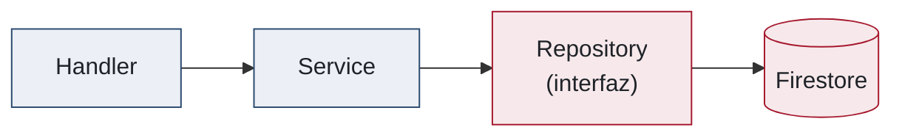
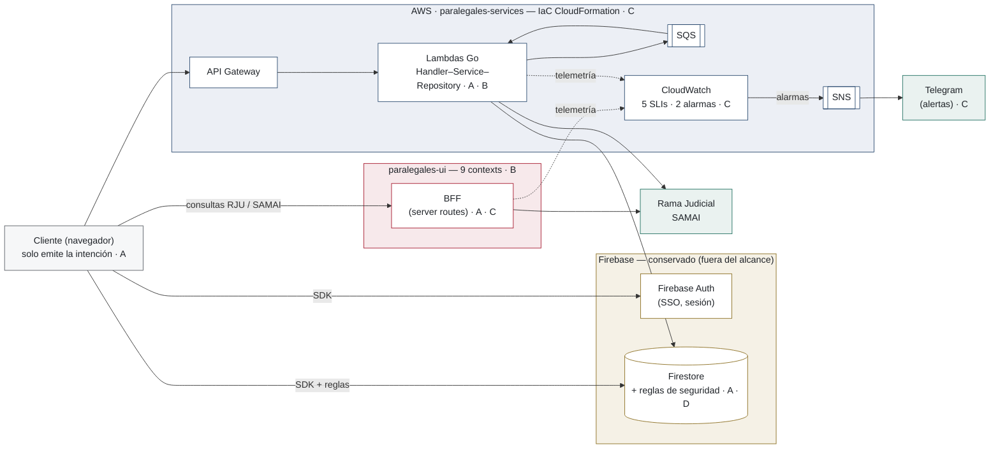

<!--
Slide 25 — Separador del Bloque 6: Resultados (~10 s; el bloque completo, ~4.5 min).

═══ GUION (leer casi literal) ═══

═══ NOTAS ═══

Anunciar el formato es lo único que hace esta slide: el jurado ya sabe leer A/B/C/D, así
que basta con decir que la estructura se repite. No adelantar ninguna cifra.
Enlaza con la salida de la demo ("lo que acaban de ver, ahora medido contra los objetivos").
-->

---
layout: two-cols-figure
---

# Resultado A — Lógica crítica fuera del cliente

<ObjectiveTag letter="A" />

::left::

- La **lógica insegura migró a Lambdas Go**: follow/unfollow, cuotas de búsqueda y vouchers se validan y ejecutan **en el servidor**
- Las consultas judiciales pasan por el **BFF**
- El acceso directo restante (Firestore vía SDK) quedó gobernado por las **reglas de seguridad**
- El navegador solo conversa con **fronteras propias**: BFF, API Gateway y Firebase

::figure::


*Pestaña Network: ninguna petición hacia dominios gubernamentales*

<EmphasisBox title="Criterio de éxito">
Evidencia verificable, no una afirmación: en el tráfico de red del navegador ninguna petición sale hacia dominios gubernamentales.
</EmphasisBox>

<!--
Slide 26 — Resultado A (~65 s).

═══ GUION (leer casi literal) ═══

"Resultado A: la lógica crítica quedó fuera del cliente. Y lo separo en los tres mecanismos
que ya vimos, porque cada uno cubre una parte distinta del problema.

Primero, la lógica insegura migró a Lambdas en Go: seguir y dejar de seguir procesos, las
cuotas de búsqueda y la redención de códigos promocionales se validan y se ejecutan en el
servidor. Ese era el peso del objetivo.

Segundo, las consultas judiciales pasan por el BFF.

Tercero, el acceso directo que se conserva —Firestore por SDK, que es lo que hace funcionar
la aplicación en tiempo real— quedó gobernado por las reglas de seguridad, que se evalúan
en los servidores de Firebase y no en el navegador.

═══ NOTAS ═══

Mapea los TRES mecanismos del objetivo A: Lambdas (el principal — la lógica insegura de los
módulos vulnerables), BFF (integraciones externas) y reglas (acceso directo a datos).
Este resultado se demuestra EN VIVO en la demo (pestaña Network abierta). Aquí la captura;
allá la prueba — señalar esa correspondencia, es lo que vuelve el resultado verificable.

El bullet 3 es un ESCUDO, no una concesión: el acceso directo a Firestore se conserva a
propósito (tiempo real, costo, latencia) y por eso las reglas son la última línea de
defensa, con su suite de pruebas en D. Si el jurado pregunta "¿entonces no sacó TODA la
lógica del cliente?": exacto, y esa es la decisión — se sacó la lógica de NEGOCIO
manipulable; la lectura de datos sigue por SDK, gobernada por reglas evaluadas del lado
del servidor.
-->

---
layout: two-cols-figure
---

# Resultado B — Arquitectura modular operativa

<ObjectiveTag letter="B" />

::left::

- Frontend organizado en **9 bounded contexts** como Nuxt Layers, tema visual aislado: **cambios localizados**, sin análisis de impacto
- Backend con **Handler–Service–Repository** y su espejo en el frontend: **componente–composable–repository**
- Los patrones quedaron **adoptados por el equipo** como estándar de las nuevas features

::figure::

```text
features/
├── active-tracking      ├── payments
├── auth                 ├── process-details
├── home                 ├── search-processes
├── my-processes         ├── terms-and-conditions
└── user-settings
```



*Los 9 bounded contexts y la cadena de tres capas del backend*

<!--
Slide 27 — Resultado B (~45 s).

═══ GUION (leer casi literal; es la más corta del bloque, señalar y seguir) ═══

"Resultado B,

El frontend quedó organizado en nueve bounded contexts o modulos, con el tema visual
aislado. La consecuencia es la que importa en una plataforma en producción: los cambios
quedan localizados — un dominio se modifica, se prueba o se reemplaza sin análisis de
impacto sobre los demás.

El backend quedó con Handler–Service–Repository, y el frontend con su espejo: componente,
composable y repositorio.

Y hay un tercer resultado que no es de código sino de proceso: estos patrones quedaron
adoptados por el equipo como el estándar de las features nuevas. Es decir, siguen operando
después de terminada la pasantía."

═══ NOTAS ═══

Evidencia estructural: la organización final del código ES el resultado.
Es la slide más corta del bloque A PROPÓSITO: los 9 bounded contexts y la cadena de tres
capas ya se vieron en las slides 19 y 20 — aquí solo se afirman como resultado. No repetir
la explicación del patrón; señalar y seguir.

El bullet 3 (adopción por el equipo) es el que NO se puede sacar de una captura: es la
contribución de proceso. Decirlo mirando a cámara, no señalando la figura.
-->

---
layout: two-cols-figure
figureHeight: 7rem
---

# Resultado C — Observabilidad operativa

<ObjectiveTag letter="C" />

::left::

- Traza **correlacionada extremo a extremo**: BFF → Lambdas → API externa, un mismo *correlation-id*
- **Dashboard de CloudWatch** en producción: **5 SLIs sobre 8 servicios**, dimensionados por servicio
- **2 alarmas** operativas: >10 errores 5xx / 5 min y p95 >5000 ms → SNS → correo y **Telegram**
- Subsistema **aprovisionado con CloudFormation**: infraestructura versionada
- **Disponibilidad de RJU/SAMAI medida**: fallo propio vs fallo del proveedor

::figure::


*El dashboard de los SLIs en producción y una acción de usuario atravesando BFF, Lambda e integración externa con el mismo correlation-id*

<EmphasisBox title="Delimitación honesta">
Sin SLOs ni error budgets aún — exigen un historial que la pasantía no alcanzó a acumular; los SLIs ya lo están construyendo.
</EmphasisBox>

<!--
Slide 28 — Resultado C (~70 s).

═══ GUION (leer casi literal; aquí SÍ dar las cifras exactas) ═══

"Resultado C, observabilidad.

Cada flujo tiene una traza correlacionada extremo a extremo: la segunda figura muestra una sola
acción de usuario atravesando el BFF, la Lambda y la integración externa, con un mismo
correlation-id.  una consulta reconstruye el viaje completo de la petición.

Lo segundo es el dashboard de CloudWatch en producción, la primera figura: cinco
indicadores de nivel de servicio sobre ocho servicios, dimensionados por servicio. No son
métricas sueltas en un namespace; es un panel que el equipo consulta.

Tercero, dos alarmas operativas: más de diez errores 5xx en cinco minutos, y percentil 95
de latencia por encima de cinco mil milisegundos. Las dos salen por SNS al correo y al canal
de Telegram del equipo.

Cuarto, todo el subsistema está aprovisionado con CloudFormation: infraestructura versionada
y recreable.

Y quinto, se mide la disponibilidad de la Rama Judicial y de SAMAI, que es lo que permite
distinguir un fallo propio de un fallo del proveedor.

==== sin SLOs ni error budgets ====
una omisión de diseño, es una cuestión de datos — fijar un objetivo de nivel de servicio
exige un historial que la pasantía no alcanzó a acumular. Los indicadores ya lo están
construyendo, y por eso los SLOs aparecen en el trabajo futuro."

═══ NOTAS ═══
Si el jurado pregunta por la observabilidad, estas son las definiciones útiles y breves:

- Traza: es el recorrido completo de una petición a través de varios servicios. Permite ver
  qué pasos ejecutó, cuánto tardó cada uno y dónde falló.
- Correlation-id: es un identificador único que se propaga junto con la petición para poder
  unir logs, métricas y trazas de la misma operación en todos los servicios.
- SLI: es la métrica que representa el nivel real de servicio. Ejemplos: tasa de errores 5xx,
  disponibilidad o latencia p95.
- SLO: es el objetivo de calidad del servicio, por ejemplo “99.9% de disponibilidad mensual”
  o “el 95% de las peticiones responde en menos de 500 ms”.
- Error budget: es el margen de error permitido para cumplir un SLO. Si el SLO es 99.9%, el
  error budget es 0.1%. Si se excede, se prioriza estabilidad y se reducen los riesgos de
  deploys.
- Alertas p95: el percentil 95 mide la latencia por debajo de la cual responde el 95% de las
  peticiones. Si sube, hay degradación de rendimiento para la mayoría de usuarios.
- Alertas 5xx: son errores del servidor (500, 502, 503, 504). Si su tasa aumenta, indica que
  la aplicación o un servicio dependiente está fallando, y la operación debe actuar.

Estas definiciones encajan con lo del dashboard: los SLIs son las métricas que alimentan el
panel, los SLOs son el objetivo y las alarmas son los disparadores operativos cuando se rompe
la calidad que el sistema se comprometió a entregar.

====
Traza = recorrido de una petición
Correlation ID = mismo identificador para seguir una petición entre servicios
SLO = objetivo de calidad
Error budget = margen permitido para no cumplir el SLO
SLI = métrica que mide el servicio
p95 = latencia del 95% de las peticiones
5xx = errores del servidor, señal de fallo operativo
====

Cifras exactas: 5 SLIs, 8 servicios, umbrales 10 errores 5xx / 5 min y p95 5000 ms.
CONFIRMAR las cifras contra el informe antes de la sustentación: son las únicas del bloque
que el jurado puede contrastar línea por línea.

Los tres resultados esperados del objetivo C (informe, tabla 5.2.3) quedan cubiertos aquí,
en este orden: (1) telemetría estructurada con correlation-id → la traza de la figura;
(2) dashboards de CloudWatch, alarmas y canal de Telegram operativos → bullets 2 y 3
más la captura del dashboard; (3) infraestructura del subsistema versionada como código
mediante CloudFormation → bullet 4. Señalar el dashboard al hablar de los SLIs: es el
artefacto que los vuelve consultables por el equipo, no solo métricas en un namespace.


La limitación (sin SLOs) es de datos, no de diseño: DECIRLA ANTES de que la pregunten —
declarada por uno mismo es rigor; arrancada en la ronda de preguntas es un hueco.
Si insisten en la diferencia SLI/SLO/error budget: el SLI es la medición (lo que hay),
el SLO es el objetivo comprometido sobre esa medición, y el error budget es el margen de
incumplimiento tolerado en una ventana. Sin historial no se puede fijar un objetivo
defendible; se fijaría un número arbitrario.
-->

---
layout: two-cols-figure
---

# Resultado D — Calidad continua y cierre de objetivos

<ObjectiveTag letter="D" />

::left::

- Commit rechazado por **Commitlint**: la compuerta local funciona (figura)
- **CI operativo** en GitHub Actions: obligatorio en cada PR a ramas protegidas

| Objetivo | Resultado obtenido |
|---|---|
| **A** | Lógica crítica en **Lambdas y BFF** — no inspeccionable ni manipulable desde el cliente |
| **B** | 9 bounded contexts + **patrones espejo** en frontend y backend |
| **C** | 5 SLIs, 2 alarmas, IaC y alertas en producción |
| **D** | Hooks + CI + **suite de 16 pruebas de las reglas** como compuerta |

::figure::


*El hook rechaza el mensaje no convencional; el pipeline condiciona la integración*

<!--
Slide 29 — Resultado D (~65 s).

═══ GUION (leer casi literal; la tabla, con ritmo — una línea por objetivo) ═══

"Resultado D, y con él la tabla que cierra los cuatro objetivos.

La evidencia de D son las dos figuras. La primera es un commit rechazado por Commitlint: la
compuerta local no es una intención, funciona y bloquea. La segunda es el pipeline de
integración continua en verde, obligatorio en cada pull request hacia las ramas protegidas.

Y la tabla responde de una vez la pregunta de fondo, objetivo por objetivo.

A: la lógica crítica quedó en Lambdas y en el BFF — no inspeccionable ni manipulable desde
el cliente.

B: nueve bounded contexts, y patrones espejo en frontend y backend.

C: cinco indicadores, dos alarmas, infraestructura como código y alertas llegando a
producción.

D: hooks locales, integración continua, y la suite de dieciséis pruebas de las reglas de
seguridad como compuerta.

Los cuatro objetivos específicos, cumplidos y con evidencia." [pausa]

═══ NOTAS ═══

La tabla cierra el ciclo académico: responde de antemano "¿cumplió los objetivos?" —
los cuatro, con evidencia. Leerla con ritmo, una línea por objetivo, sin ampliar ninguna:
cada una ya tuvo su slide. Si te extiendes aquí, la redundancia le resta fuerza.

Al terminar, transición a la slide de cierre: "y así queda el mapa completo".
-->

---

# Arquitectura híbrida resultante



*El mismo mapa del desarrollo y el mismo sustrato de proveedores del punto de partida — anotado con la línea de intervención que transformó cada región*

<!--
Slide 30 — cierre de Resultados (~25 s).

═══ GUION (leer casi literal; SEÑALANDO, sin recorrer el diagrama) ═══

"Y así queda el mapa completo. Es el mismo diagrama que vimos en el desarrollo, ahora
anotado: cada región lleva la letra del objetivo que la transformó. El cliente, que ahora
solo emite la intención, con A. El frontend en nueve contextos, con B. CloudWatch y
CloudFormation, con C. Y las reglas de Firestore, con A y con D."

═══ NOTAS ═══

Es el REPRISE del mapa de desarrollo (slide 16), no una slide nueva: por eso cuesta poco
tiempo y se reconoce de inmediato. Función: cerrar el círculo visual que la tabla cierra en
texto, y formar el "bookend" con el diagrama del punto de partida (slide 5) — mismo
proveedor, arquitectura distinta.

A 25 s NO se recorre el diagrama: se enuncian las cuatro letras señalando su región y se
pasa al cierre. El guion de abajo es la versión ampliada, para preguntas.

Guion extendido (si hay tiempo o lo piden, señalando): "el mismo mapa, ahora con las cuatro
líneas encima. A: el cliente solo emite la intención, la lógica vive en Lambdas y en el BFF,
y las reglas quedan como última línea de defensa. B: nueve bounded contexts en el frontend y
Handler–Service–Repository en el backend. C: telemetría desde ambas capas hacia CloudWatch,
alarmas a Telegram, todo aprovisionado como código. D: esas reglas de seguridad son el
artefacto con suite propia y compuerta en el CI."

OJO: Firebase aparece rotulado como "conservado (fuera del alcance)" A PROPÓSITO —
adelanta la exclusión (b) del alcance y desactiva la pregunta "¿por qué sigue ahí?".
Si la hacen igual, la slide de apoyo "¿Por qué no migrar todo a AWS?" está lista.
-->

