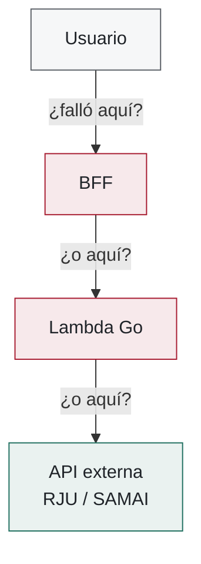
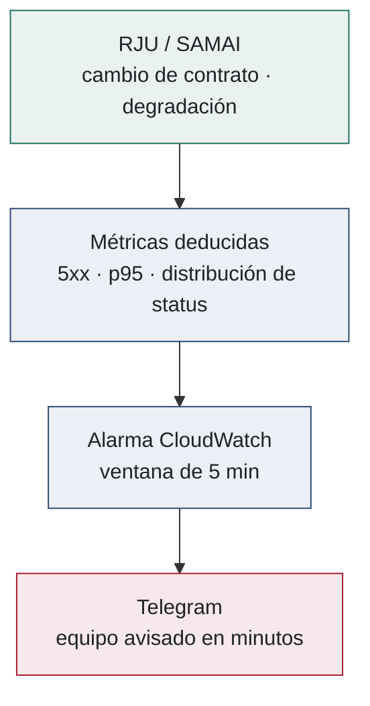

# ¿Por qué es vital la observabilidad aquí?

<BackupBadge />

::left::

- Una acción del usuario atraviesa **múltiples componentes distribuidos**: BFF, API Gateway, Lambdas, colas y proveedores externos
- Sin correlación, cada log es **una isla**: reconstruir el viaje de una petición es arqueología manual
- Flujos **síncronos y asíncronos** conviven: el fallo puede aflorar **lejos de su causa**
- Con un **correlation-id** propagado extremo a extremo, la pregunta se responde en segundos: todos los eventos de *esa* petición, a través de todos los saltos

::figure::

*"El sistema está fallando" — ¿dónde? Sin trazas correlacionadas no hay respuesta rápida*

<!--
Diapositiva de apoyo — el PORQUÉ del objetivo C (informe, 7.6: "una única acción puede
atravesar múltiples componentes, redes y servicios distribuidos").
Era una slide del guion largo; ahora este argumento se dice hablado en ~15 s al abrir la
slide 21 (Observabilidad transversal). Esta slide se usa solo si el jurado pide el detalle.

Ejemplo hablado: un abogado reporta "no me cargan los procesos". ¿Es el BFF? ¿La Lambda?
¿La Rama Judicial caída? Sin correlation-id: revisar 4 sistemas a ciegas. Con él:
una consulta en Logs Insights y aparece el viaje completo de esa petición.
-->

---
layout: two-cols-figure
columns: 1.05fr 1fr
---

# Vigilar lo que no controlamos: RJU y SAMAI

<BackupBadge />

::left::

- Las integraciones críticas dependen de **infraestructura ajena**: sin SLA, sin versionado, **sin aviso de cambios** (API no documentada)
- Un **cambio de contrato** o una **caída del proveedor** se manifiesta como picos de errores, latencia o respuestas inesperadas
- Los **filtros de métricas** convierten esos síntomas en señal: tasa de 5xx, latencia p95, distribución de códigos de estado
- Alarmas en ventanas de 5 min → SNS → **Telegram**: el equipo se entera **antes que los usuarios**
- Distinguir en segundos **fallo propio vs fallo del proveedor**: no depurar lo que no está roto

::figure::

*Medición objetiva de la disponibilidad de los proveedores: de percepción a dato*

<!--
Diapositiva de apoyo — el caso de negocio de la observabilidad: el producto ENTERO depende
de portales gubernamentales que mañana pueden cambiar el contrato o caerse sin aviso
(la integración es por ingeniería inversa: nadie nos va a notificar).
Usar si preguntan por la vigilancia de proveedores externos o por el valor de negocio del
objetivo C más allá del diagnóstico interno.

Beneficios documentados en el informe (7.6 y resultado C): medición objetiva de la
disponibilidad de las APIs gubernamentales, trazabilidad de errores por usuario,
mitigación antes de que los usuarios perciban el fallo.
Implementación real: shared/observability/ (logging.go, context.go) en paralegales-services.
-->

---
layout: two-cols-figure
---

# Gestión del trabajo con el equipo

<BackupBadge />

::left::

- Kanban del proyecto: de WebDesk (interno) a **Plane**, *open source* y autoalojado sobre infraestructura de Webcloster
- Backlog priorizado por sprint con **Product Owner** y **Tech Lead**
- **Google Meet** para sprint planning · **Discord** para pair programming y revisión de código
- **Telegram** para comunicación asíncrona y notificaciones técnicas del sistema

::figure::

*Backlog y flujo de trabajo en Plane; canal asíncrono del equipo en Telegram*

<!--
Diapositiva de apoyo — versión extendida de la gestión del trabajo, con el canal de
Telegram del equipo. Su contenido está comprimido en la slide 13 (Metodología y gestión
del trabajo); esta se usa si el jurado pide detalle sobre la dinámica con la empresa.
Ese mismo canal de Telegram reaparece en la slide 21 recibiendo alertas de producción.
-->
