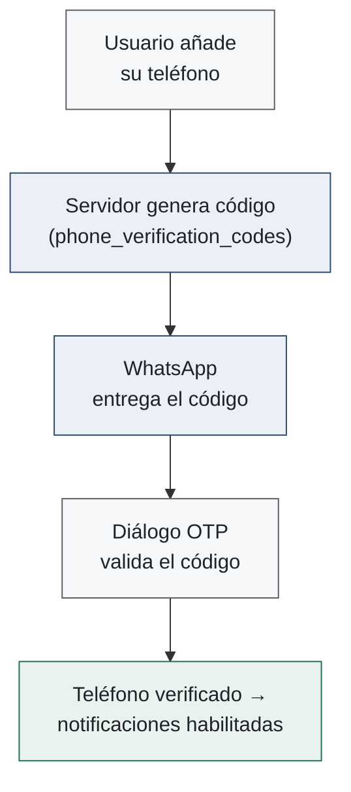
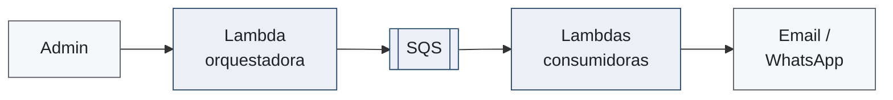

# Autenticación: registro, acceso y recuperación

<BackupBadge />

::left::

- Gestión de identidades **delegada a Firebase Auth** (infraestructura probada de Google)
- Registro e inicio de sesión con **validación reactiva** en tiempo real
- **SSO con Google** con lógica condicional: evita perfiles duplicados
- **Verificación de correo obligatoria**: acceso bloqueado hasta confirmar identidad
- **Recuperación de contraseña** autónoma vía enlace al correo verificado

::figure::

*Inicio de sesión y registro con validación reactiva*

<!--
Apoyo / índice de la DEMO — capítulos "Autenticación: registro y validación reactiva"
(00:13) y "Verificación del correo (Mailinator)" (01:20).
Fundamentos aplicados: componentes modulares + capas lógicas independientes del SDK
(previene condiciones de carrera, informe 7.3).
-->

---
layout: two-cols-figure
figureHeight: 14rem
---

# Autenticación: onboarding de perfilación

<BackupBadge />

::left::

- Tras el registro, una **encuesta dinámica** de perfilación profesional
- Captura **especialidad legal, profesión base y años de experiencia**
- **Validación de esquemas en el cliente** y sincronización inmediata con Firestore
- Permite **adaptar la funcionalidad** de la plataforma a cada perfil

::figure::

*Flujo de onboarding: perfilación progresiva del usuario tras el registro*

<!--
Apoyo / índice de la DEMO — capítulo "Onboarding: encuesta de perfilación" (02:06).
Onboarding = inicialización progresiva (informe 7.3): cada paso conduce al usuario por
preguntas progresivas hasta completar su perfil inicial.
-->

---
layout: two-cols-figure
---

# Autenticación: verificación OTP del teléfono

<BackupBadge />

::left::

- El teléfono para **notificaciones de WhatsApp** se verifica con un **código de un solo uso**
- Código generado en el servidor, persistido en la colección `phone_verification_codes` y **entregado por WhatsApp** (Twilio)
- Un **diálogo OTP** valida el código y marca el número como verificado
- Construido con el patrón **componente–composable–repository** (`OtpDialog` · `useUpdateUserPhones` · repositorio)

::figure::

*Verificación del canal antes de habilitar notificaciones de WhatsApp*

<!--
Apoyo / índice de la DEMO — capítulo "Verificación OTP del teléfono (WhatsApp)" (03:05).
OJO: el informe no dedica una sección al OTP — el respaldo está en el código
(features/user-settings: OtpDialog.vue, useUpdateUserPhones.ts,
common/models/verification_codes.ts). Presentarlo como mejora del producto que aplica
el patrón del objetivo B; no citar "sección del informe" si preguntan.
-->

---
layout: two-cols-figure
figureHeight: 14rem
---

# Procesos: panel de control (dashboard)

<BackupBadge />

::left::

- **Punto de entrada** del usuario autenticado
- **Tarjetas y widgets modulares** en cuadrícula adaptativa
- Consolida **estadísticas, estado de los planes activos** y procesos recientes
- **Acciones rápidas** sin navegar en profundidad por la plataforma

::figure::

*Dashboard con estadísticas, planes y accesos directos*

<!--
Apoyo / índice de la DEMO — capítulo "Panel de control" (09:48).
Diseño modular (informe 7.4): reduce la fricción operativa y facilita la toma de
decisiones desde una sola vista.
-->

---
layout: two-cols-figure
---

# Procesos: búsqueda e integración con la RJU

<BackupBadge />

::left::

- La Rama Judicial **no ofrece API documentada** → **ingeniería inversa**: interceptar, analizar y mapear el tráfico del portal oficial
- Endpoints y payloads identificados: parametrización (departamento, ciudad, especialidad, entidad) y búsqueda por **radicado o nombre**
- **Proxy en el BFF**: CORS resuelto, esquemas estandarizados, observabilidad y logs de auditoría
- Vista de resultados **tabular con indicadores de estado**

::figure::

*Búsqueda avanzada con filtros combinables y resultados*

<!--
Apoyo / índice de la DEMO — capítulo "Búsqueda e integración con la Rama Judicial" (10:16).
EL capítulo más importante del video: reproducirlo CON LA PESTAÑA NETWORK ABIERTA, porque
demuestra el Resultado A en vivo (ninguna petición hacia dominios gubernamentales).
Conecta directo con la slide 18 ([A·2], el wrapper) y con la slide 26 (Resultado A).
Es el trabajo técnico diferencial de la plataforma.
-->

---
layout: two-cols-figure
figureHeight: 13rem
---

# Procesos: seguimiento (follow / unfollow)

<BackupBadge />

::left::

- **Componentes atómicos reutilizables**: botones interactivos con estados de carga
- La lógica de interacción abstraída en **composables**; la comunicación de red en **repositorios**
- La **orquestación de asociar / desvincular se delegó al backend**: el frontend solo emite la intención y reacciona al resultado
- Experiencia **reactiva e instantánea** para el usuario

::figure::

*Acción de seguimiento integrada en la vista de resultados*

<!--
Apoyo / índice de la DEMO — capítulo "Seguimiento de procesos y Mis Procesos" (11:25).
Aplica DOS fundamentos a la vez: el patrón componente–composable–repository (slide 20)
y la delegación de la lógica al servidor (slide 17, [A·1]) — es el mismo flujo cuya
migración se mostró allí.
-->

---
layout: two-cols-figure
figureHeight: 13rem
---

# Procesos: gestión y visualización — "Mis Procesos"

<BackupBadge />

::left::

- **Panel personal**: todos los procesos bajo seguimiento en un solo lugar
- Tarjetas con **radicado, entidad, estado y fecha de última actuación**
- Recuperación **asíncrona** de la lista vinculada al usuario autenticado
- Cancelar un seguimiento se refleja **en tiempo real**, sin recargar la página

::figure::

*"Mis Procesos": los expedientes bajo seguimiento del usuario*

<!--
Apoyo / índice de la DEMO — segunda mitad del capítulo "Seguimiento de procesos y
Mis Procesos" (11:25).
Reutiliza la abstracción de follow/unfollow: mismo composable, otra vista — la
modularidad (objetivo B) en acción.
-->

---
layout: two-cols-figure
---

# Procesos: Seguimientos Activos

<BackupBadge />

::left::

- Delega al sistema la **búsqueda diaria automática** por **NIT o razón social** contra Rama Judicial y **SAMAI**
- La creación exige un **plan de suscripción activo**: integra la operación con la facturación
- Vista de detalle **en pestañas**: procesos encontrados vs lista blanca
- Clasificación interactiva: **aprobar** (lista blanca) o **descartar** (lista negra) → depura homónimos e irrelevantes

::figure::

*Configuración y clasificación de hallazgos de un Seguimiento Activo*

<!--
Apoyo / índice de la DEMO — capítulo "Seguimientos Activos" (15:35).
El diferenciador del producto: el sistema busca por el usuario cada día. Detrás:
Lambdas Go programadas (A) + composables reactivos (B) + telemetría de las consultas a
RJU/SAMAI (C). Es el módulo que más fundamentos integra — buen capítulo para detenerse
en la demo si hay tiempo.
-->

---
layout: two-cols-figure
---

# Módulo de campañas (event-driven)

<BackupBadge />

::left::

- Envíos masivos multicanal: **correo electrónico y WhatsApp** (Twilio)
- Una Lambda **orquestadora** valida, desglosa destinatarios y encola instrucciones en **SQS**
- Funciones consumidoras resuelven plantillas con variables dinámicas y enrutan al proveedor
- El administrador **no espera el envío**: la cola desacopla la UI de la latencia externa

::figure::

*Vista principal del módulo de campañas en el portal administrativo*

<!--
Apoyo / índice de la DEMO — capítulo "Módulo de campañas (portal administrativo)" (17:45).
Caso de arquitectura asíncrona: procesar altos volúmenes sin timeouts.
Es el módulo con más peso arquitectónico de los que quedaron fuera del guion hablado;
si el jurado pregunta por SQS/SNS o por procesamiento asíncrono, esta es la slide.
-->
